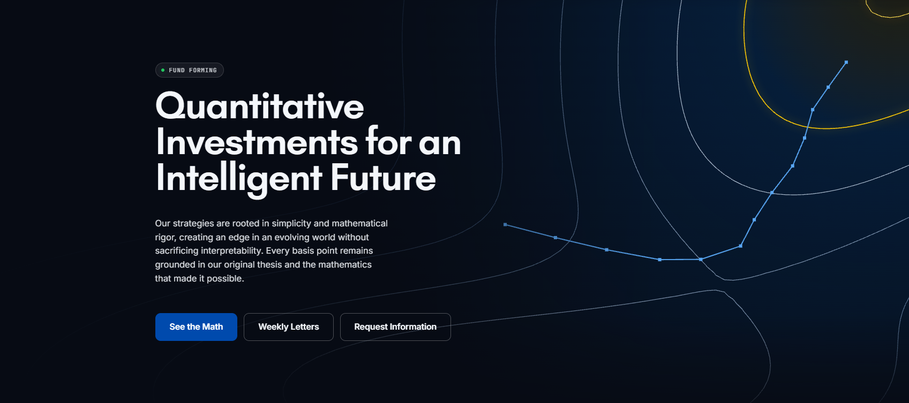

## 📚 Lecture Video Library

I quite enjoy lecturing about quantitative topics.

I have 100+ lecture videos available from randomized numerical linear algebra to the simulation of fractional Brownian motion.

[YouTube Channel](https://youtube.com/@QuantGuild)

I've also created a repo containing all of the relevant resources for each video lecture.

[Jupyter Notebook Library](https://github.com/romanmichaelpaolucci/Quant-Guild-Library)

---

## 📫 Connect with Me

**Socials:**
* **Instagram:** [@quantguild](https://www.instagram.com/quantguild)
* **TikTok:** [@quantguild](https://www.tiktok.com/@quantguild)
* **Medium:** [@quantguild](https://medium.com/@quantguild)
* **X (Twitter):** [@quantguild](https://x.com/quantguild)
* **LinkedIn (Personal):** [rmp99](https://www.linkedin.com/in/rmp99/)
* **LinkedIn (Company):**[@quantguild](https://www.linkedin.com/company/quant-guild)

*To inquire about a seminar for your student group or organization please reach out to the following email:*
- 📩 support [at] quantguild [dot] com
---

